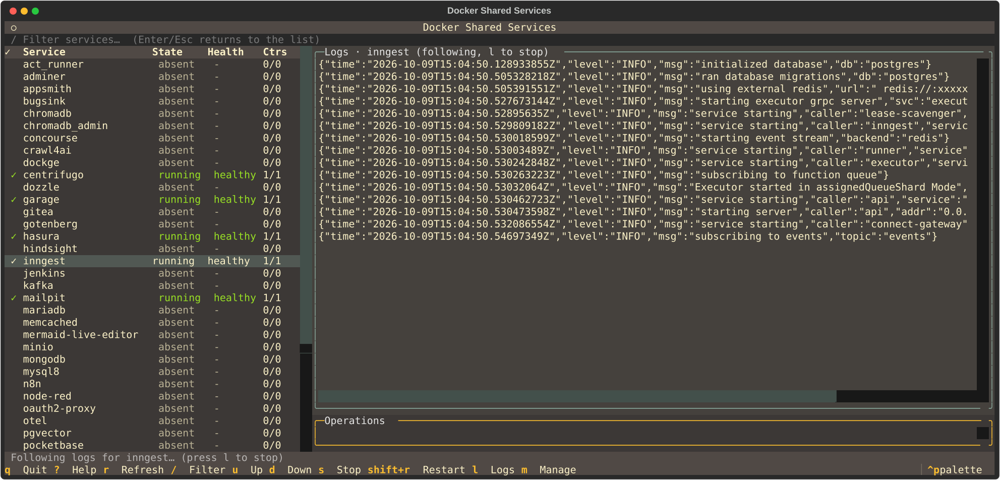

# Docker Shared Services



Local Docker Compose stack for common infra: databases, cache, messaging, CI/CD, auth, storage, and observability. Managed with a `Makefile` + the `dss/` Python package (run through `uv`).

**macOS / Linux only.** Windows is unsupported (WSL2 may work, untested).

> **Local development only.** Host ports bind to `127.0.0.1`. Do not expose this stack to the internet.

## Quick start

```bash
# 1) Networks, .env files, shared password, optional TLS certs
make setup
# Or choose a secure shared password:
#   make setup password='your-secure-password'

# 2) Start what you need
make up                        # interactive
make up service=postgres       # one service (folder name)

# 3) Check
make ps
make info                      # URLs / ports
```

Access via Traefik: `https://<service>.dss.localhost` (needs `make cert` / mkcert once).
Use the domain names for browser UIs. Verdaccio also exposes `http://127.0.0.1:4873/` for host package managers.
Run `make setup` before any direct `docker compose up`; Compose requires the generated `.env` files and credentials.
The Traefik dashboard is at `https://traefik.dss.localhost/dashboard/` with username `admin` and the shared password in the root `.env`.

## Shared password

`make setup` writes **one** password into all service password fields (Postgres, Redis, MinIO, Grafana, …). Unique secrets (Garage, Woodpecker agent, Zitadel masterkey, oauth2-proxy cookie secret) stay separate.

| Goal                   | Command                                                 |
| ---------------------- | ------------------------------------------------------- |
| Random shared password | `make setup`                                            |
| Choose a password      | `make setup password='your-secure-password'`            |
| Same via env           | `DSS_SHARED_PASSWORD='your-secure-password' make setup` |
| Rotate later           | `make passwords password='NewPass' force=1`             |

Value is stored as `DSS_SHARED_PASSWORD` in the root `.env`.

## Common commands

| Command                                 | What it does                                                   |
| --------------------------------------- | -------------------------------------------------------------- |
| `make setup`                            | Networks, `.env`, shared password, Dozzle user, optional certs |
| `make passwords`                        | Apply / rotate the shared password                             |
| `make up` / `down` / `stop` / `restart` | Lifecycle (`service=<folder>` optional)                        |
| `make manage`                           | Interactive multi-select start/stop                            |
| `make tui`                              | Optional Textual dashboard (needs `uv` + interactive TTY)      |
| `make logs` / `ps` / `health` / `info`  | Observe                                                        |
| `make cert`                             | TLS for `*.dss.localhost` (requires mkcert)                    |
| `make validate`                         | Validate all compose files                                     |
| `make remove-config`                    | Delete generated `.env` files (confirm)                        |
| `make remove-all`                       | **Wipe containers + volumes** (confirm)                        |

```bash
make up service=redis
make logs service=gitea
make restart service=postgres
```

### Optional Textual dashboard

`make tui` opens a keyboard-driven terminal UI for status, health, logs, and the same lifecycle actions as `make up` / `down` / `stop` / `restart` / `manage`. Existing Makefile and CLI workflows are unchanged.

```bash
uv sync --group tui   # once: install optional Textual + Docker SDK deps
make tui              # interactive terminal required
```

Press `?` inside the TUI for key bindings. Status updates automatically from Docker events. Press `l` on a service to follow its logs live (like `make logs`); press `l` again to stop. Press `m` and confirm to leave the dashboard and apply the manage plan in the terminal, so large image pulls show Docker progress. Without a TTY, the command prints how to use `make manage` / `make up` / `make ps` instead.

## What’s included

| Area        | Examples                                                                                        |
| ----------- | ----------------------------------------------------------------------------------------------- |
| Data        | Postgres 16, PgVector 17, MySQL, MariaDB, MongoDB, Redis, Memcached, ChromaDB, Qdrant           |
| Messaging   | RabbitMQ, Kafka, Centrifugo                                                                     |
| Auth / apps | Zitadel, oauth2-proxy (`auth.dss.localhost`), Supabase, Gitea, n8n, Appsmith, Hindsight, Hasura |
| CI / ops    | Jenkins, Concourse, Woodpecker, SonarQube, Portainer, Dockge, Dozzle                            |
| Storage     | MinIO, Garage                                                                                   |
| Dev tools   | Verdaccio npm registry                                                                          |
| Edge / obs  | Traefik, OTel (Collector + Loki + Alloy + Grafana )                                             |

Full catalog: [docs/services.md](docs/services.md).

## Layout

```
docker-compose.shared.yml   # networks: traefik_proxy, backend_net, data_net
Makefile                    # day-to-day commands
dss/                        # Python: core logic, CLIs, packager, TUI
tools/                      # dev tooling (formatter, file-size check)
scripts/                    # shell called by Makefile recipes (networks, certs, Dozzle users, cleanup)
<service>/                  # docker-compose.yml + .env.example
docs/                       # deeper guides
```

## Opt-in UI authentication

Selected Traefik UIs can require Zitadel login via `oauth2-proxy` (`https://auth.dss.localhost`). Auth is **off by default**. `make setup` only requires the oauth2-proxy cookie secret; Zitadel client id/secret are a prerequisite when you configure the gateway.

1. Start Traefik + Zitadel + oauth2-proxy (register a Zitadel Web app and set client credentials — see [oauth2-proxy/README.md](oauth2-proxy/README.md)).
1. In a candidate service `.env` set `AUTH_ENABLED=true` and `AUTH_MIDDLEWARE=auth-default`, then restart that service.
1. Candidates (remain disabled until you opt in): Mermaid Live Editor, Temporal UI, ChromaDB, Qdrant, Kafka UI.

For Mermaid Live Editor, `AUTH_ENABLED=true` alone is not sufficient; make sure `AUTH_MIDDLEWARE=auth-default` is set instead of the default `auth-none`.

Details: [docs/configuration.md](docs/configuration.md#opt-in-zitadel-ui-authentication).

## Docs

- [Services & access](docs/services.md)
- [Configuration & networking](docs/configuration.md)
- [Usage](docs/usage.md)
- [Troubleshooting](docs/troubleshooting.md)

## Requirements

Docker Engine 20.10+, Compose v2+, Make, and [uv](https://docs.astral.sh/uv/) (it runs every Python target on Python 3.12). Optional: [mkcert](https://github.com/FiloSottile/mkcert) for local HTTPS.

## License

See [LICENSE](LICENSE). Issues and PRs welcome.
