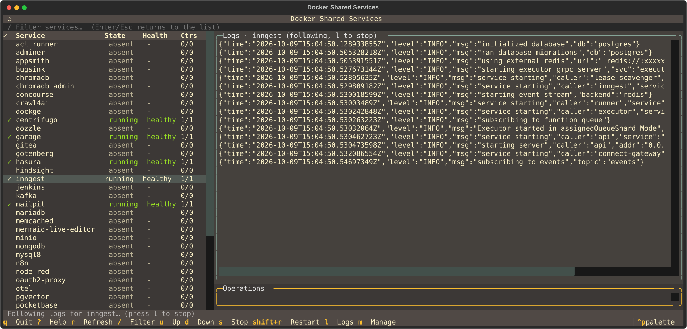

# Docker Shared Services



Local Docker Compose stack for common infra: databases, cache, messaging, CI/CD, auth, storage, and observability. Managed with a `Makefile` + the `dss` Rust binary in `cli/` (built with `cargo`).

**macOS / Linux only.** Windows is unsupported (WSL2 may work, untested).

> **Local development only.** Host ports bind to `127.0.0.1`. Do not expose this stack to the internet.

## Quick start

```bash
# 1) Networks, .env files, shared password
make setup
# Or choose a secure shared password:
#   make setup password='your-secure-password'

# 2) TLS edge (sibling docker-shared-services-proxy repo)
#    make setup && make cert && make up

# 3) Start what you need
make console                                   # interactive management console
cli/target/release/dss up --service postgres   # one service (folder name)

# 4) Check
cli/target/release/dss ps
cli/target/release/dss info                    # URLs / ports
```

HTTPS uses **Caddy** in the companion [docker-shared-services-proxy](https://github.com/tranthethang/docker-shared-services-proxy) repo (`make cert` + `make up` there). Traefik in this repo routes **HTTP only** on `traefik_proxy`; start Caddy before Traefik for browser access.

Access UIs at `https://<service>.sandbox.localhost` when Caddy and Traefik are running.
Use the domain names for browser UIs. Verdaccio also exposes `http://127.0.0.1:4873/` for host package managers.
Run `make setup` before any direct `docker compose up`; Compose requires the generated `.env` files and credentials.
The Traefik dashboard is at `https://traefik.sandbox.localhost/dashboard/` with username `admin` and the shared password in the root `.env`.

## Shared password

`make setup` writes **one** password into all service password fields (Postgres, Redis, MinIO, Grafana, …). Unique secrets (Garage, Woodpecker agent, Zitadel masterkey, oauth2-proxy cookie secret) stay separate.

| Goal                   | Command                                                              |
| ---------------------- | -------------------------------------------------------------------- |
| Random shared password | `make setup`                                                         |
| Choose a password      | `make setup password='your-secure-password'`                         |
| Same via env           | `DSS_SHARED_PASSWORD='your-secure-password' make setup`              |
| Rotate later           | `cli/target/release/dss env passwords --password 'NewPass' --force`  |

Value is stored as `DSS_SHARED_PASSWORD` in the root `.env`.

## Common commands

| Command                                           | What it does                                 |
| ------------------------------------------------- | -------------------------------------------- |
| `make setup`                                      | Networks, `.env`, shared password, Dozzle    |
| `make console`                                    | Management console (needs an interactive TTY) |
| `make package`                                    | Package a selected stack into `dist/`        |
| `make validate`                                   | Validate all compose files                   |
| `make build`                                      | Build `cli/target/release/dss`               |
| `cli/target/release/dss up --service <folder>`    | Start one service (and its backends)         |
| `cli/target/release/dss ps` / `health` / `info`   | Observe status, health, and URLs             |
| `cli/target/release/dss remove-config`            | Delete generated `.env` files (confirm)      |
| `cli/target/release/dss teardown`                 | **Wipe containers + volumes** (confirm)      |

```bash
cli/target/release/dss up --service redis
cli/target/release/dss logs --service gitea
cli/target/release/dss restart --service postgres
```

### Dashboard

`make console` opens a keyboard-driven terminal UI (ratatui) for status, health, logs, and lifecycle actions (`up`, `down`, `stop`, `restart`, multi-select `manage`).

```bash
make console          # interactive terminal required
```

Press `?` inside the dashboard for key bindings. Status updates automatically from Docker events. Press `l` on a service to follow its logs live (like `dss logs`); press `l` again to stop. Select services with `Space`, then press `m` and confirm to start the selected services and stop the rest. Without a TTY, use `cli/target/release/dss up --service <name>`, `cli/target/release/dss ps`, or `cli/target/release/dss --help`.

Switch the dashboard color theme with `DSS_THEME` (`gruvbox-light-soft` default, `ocean`, `amber`, `nord`):

```bash
DSS_THEME=ocean make console
```

## What’s included

| Area        | Examples                                                                                            |
| ----------- | --------------------------------------------------------------------------------------------------- |
| Data        | Postgres 16, PgVector 17, MySQL, MariaDB, MongoDB, Redis, Memcached, ChromaDB, Qdrant               |
| Messaging   | RabbitMQ, Kafka, Centrifugo                                                                         |
| Auth / apps | Zitadel, oauth2-proxy (`auth.sandbox.localhost`), Supabase, Gitea, n8n, Appsmith, Hindsight, Hasura |
| CI / ops    | Jenkins, Concourse, Woodpecker, SonarQube, Portainer, Dockge, Dozzle                                |
| Storage     | MinIO, Garage                                                                                       |
| Dev tools   | Verdaccio npm registry                                                                              |
| Edge / obs  | Caddy (proxy repo), Traefik, OTel (Collector + Loki + Alloy + Grafana )                             |

Full catalog: [docs/services.md](docs/services.md).

## Layout

```
docker-compose.shared.yml   # networks: traefik_proxy, backend_net, data_net
Makefile                    # day-to-day commands
cli/                        # Rust crate `dss`: lifecycle, env and secrets, dashboard, packager
<service>/                  # docker-compose.yml + .env.example
docs/                       # deeper guides
```

## Opt-in UI authentication

Selected Traefik UIs can require login through `oauth2-proxy` (`https://auth.sandbox.localhost`) with any OIDC issuer. Auth is **off by default**. `make setup` only requires the oauth2-proxy cookie secret; an OIDC client id/secret are prerequisites when you configure the gateway.

1. Start Traefik, register a confidential OIDC client with the callback URL, and set the issuer URL and client credentials in `oauth2-proxy/.env`. Then start oauth2-proxy. See [oauth2-proxy/README.md](oauth2-proxy/README.md).
1. In a candidate service `.env` set `AUTH_ENABLED=true` and `AUTH_MIDDLEWARE=auth-default`, then restart that service.
1. Candidates (remain disabled until you opt in): Mermaid Live Editor, Temporal UI, ChromaDB, Qdrant, Kafka UI.

For Mermaid Live Editor, `AUTH_ENABLED=true` alone is not sufficient; make sure `AUTH_MIDDLEWARE=auth-default` is set instead of the default `auth-none`.

Details: [docs/configuration.md](docs/configuration.md#opt-in-oidc-ui-authentication).

## Docs

- [Services & access](docs/services.md)
- [Configuration & networking](docs/configuration.md)
- [Usage](docs/usage.md)
- [Troubleshooting](docs/troubleshooting.md)

## Requirements

Docker Engine 20.10+, Compose v2+, Make, and a [Rust toolchain](https://rustup.rs/) (`cargo` builds the `dss` binary on first use). For HTTPS in the browser, clone [docker-shared-services-proxy](https://github.com/tranthethang/docker-shared-services-proxy) and install [mkcert](https://github.com/FiloSottile/mkcert) there.

## License

See [LICENSE](LICENSE). Issues and PRs welcome.
